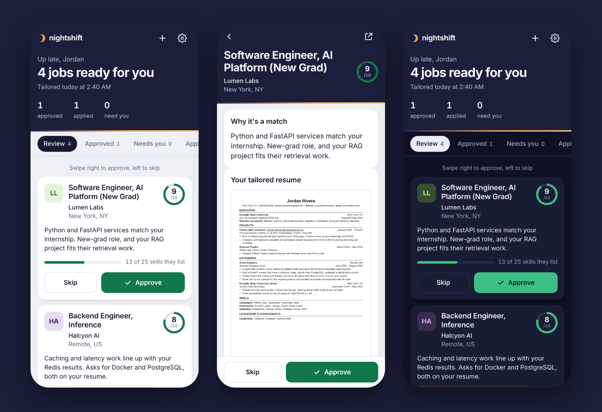

# nightshift

**A job-search agent that works while you sleep and never lies on your resume.**

Every night nightshift pulls new postings from the companies you care about, filters and ranks them, and tailors your resume (or CV) and cover letter to each good match. In the morning your phone buzzes; you open the app and swipe right to approve, left to skip. Approved applications are filled in and submitted for you. Submitting is opt-in and can stay off.



## Why another one?

Open-source auto-appliers already exist. AIHawk is the best known, and newer agents like ApplyPilot apply to hundreds of jobs a day. There are also plenty of single-shot resume tailors. They share two problems:

1. **Truthfulness is a prompt, not a guarantee.** They *ask* the model not to invent things. LLMs still inflate metrics, add the job description's tech stack to your bullets, and turn "collaborated on" into "led". One popular tailor even ships a "fabrication level" slider.
2. **Fire-and-forget volume.** Mass auto-applying gets accounts flagged, answers screening questions (work authorization, sponsorship, salary) by guessing, and a pile of generic applications rarely beats fewer good ones.

nightshift's answer:

| | |
|---|---|
| **A guard enforced in code** | Every tailored bullet must cite the master-profile bullets it came from. Numbers, technologies and ownership verbs are checked against those sources. Anything that fails is reverted to your original wording and shown to you. |
| **You approve, it does the busywork** | Discovery, ranking, tailoring and form-filling happen overnight. Required questions it can't answer from your profile or `answers.yaml` are **never guessed**; that job goes to *Needs you*. |
| **No scraping** | Jobs come from the public job-board APIs Greenhouse, Lever and Ashby provide for every company careers page. No LinkedIn bots, no logins, full descriptions. |
| **Honest gap report** | Keywords the job wants that you *don't* have are listed separately and never added. That list is your study plan. |
| **Resume or CV by country** | US/Canada roles get a 1-page Letter resume. UK, Ireland, EU, Australia and NZ roles get a 2-page A4 CV (configurable). |

## What the guard checks

For every tailored bullet, against the bullets it cites from **the same job or project**:

| Rule | Catches |
|---|---|
| provenance | bullets with no source, or "borrowed" from a different job |
| numbers | any number or "doubled/tripled" that isn't in the source (`20%` → `40%`, invented user counts) |
| technology | a tool not used in *that* role (the JD's Kubernetes, or your Docker moved into an internship that never used it) |
| role | `led / managed / architected / owned / mentored…` when the source has no such verb |
| length | bullets that won't fit on two lines |

Skills and coursework must exist in your profile. Summaries and cover letters get the same number and technology checks. In a cover letter, sentences about the *company* are free, but any sentence about *you* that claims something not in your profile is removed.

## How a night runs

```
discover ─► filter ─► pre-rank ─► LLM score ─► tailor ─► guard ─► fit to page ─► queue
 (APIs)    (title,    (keyword    (1–10 +      (select,   (revert   (densify, drop
           location,   overlap,    red flags)   reorder,   anything  least-relevant
           age, visa)  free)                    reword)    unbacked) bullets, refill)
```

- **Pre-rank** uses a deterministic keyword taxonomy, so only the best ~60 postings per night cost model tokens.
- **Fit to page** renders the real PDF with headless Chrome and counts pages. It drops bullets that are irrelevant to *this* job first, then tightens spacing, then trims the least relevant. Finally it puts back the most relevant bullets that still fit, so the page doesn't end with a gap.
- Output per job: tailored PDF, plain-text version (what an ATS sees), cover letter PDF, and a JSON record of every change and guard decision.

## Run it in the cloud, use it from your phone

`nightshift server` is the always-on mode: the app plus a built-in nightly schedule, behind a password. Deploy it once to Fly.io with the included `Dockerfile` and `fly.toml` (step by step in [DEPLOY.md](DEPLOY.md)), add it to your home screen, and install ntfy for the morning notification. Everything after that, including editing your profile and answers, happens in the app.

## Quick start (on your laptop)

```bash
git clone https://github.com/rishikgbs04/nightshift && cd nightshift
python -m venv .venv && source .venv/bin/activate
pip install -e .
playwright install chromium        # only if you don't have Google Chrome

nightshift init                    # creates config.yaml, profile.yaml, answers.yaml
export ANTHROPIC_API_KEY=...       # or use provider: openai / offline in config.yaml
```

Put your real resume into `profile.yaml`. Include **more** than fits on a page; tailoring picks what each job needs. These three files are git-ignored and never leave your machine except as prompts to the model provider you configure.

```bash
# one job, right now
nightshift tailor https://boards.greenhouse.io/somecompany/jobs/1234567
nightshift tailor job.txt --company "Acme" --location "London, UK"   # → 2-page A4 CV

# the overnight loop
nightshift boards                  # check the company slugs in config.yaml
nightshift run                     # discover → tailor → queue
nightshift serve                   # review at http://127.0.0.1:8765
nightshift schedule --install      # every night at 2:17 (launchd on macOS, cron on Linux)
```

Try it without any personal data or API key:

```bash
python scripts/demo.py /tmp/nightshift-demo
nightshift serve --config /tmp/nightshift-demo/config.yaml
```

### Offline mode

`llm.provider: offline` (or `--offline`) tailors without a model: bullets, projects, skills and coursework are reordered by relevance to the job, and the wording is never changed. Scoring uses keyword fit. Useful for zero-cost runs or if you'd rather do the rewording yourself.

### Any model

`provider: anthropic` uses the Messages API. `provider: openai` speaks the OpenAI chat-completions format to any `base_url`, so local models and LLM gateways work too.

### Autopilot: 50 applications a day

Once you trust the output, nightshift can run end to end:

```yaml
companies:
  include_defaults: true          # ~300 bundled tech companies (run `nightshift boards --prune` once)
pipeline:
  max_llm_scoring_per_run: 200
  max_tailor_per_run: 60
  auto_approve_min_score: 8       # 8+/10 skip your review; the rest still wait for you
  max_per_company_per_run: 3      # never flood one company
submit:
  enabled: true
  live: true                      # start with false for a week and check form.png
  max_per_day: 50
  delay_seconds: [45, 180]        # spread applications out
  answer_open_questions: true
```

- **Auto-approve** only applies to clean jobs: anything flagged (e.g. "won't sponsor") or tailored without the model still waits for you.
- **Open-ended questions** ("Why do you want to work here?") are drafted from your profile and the posting, then run through the same guard. Sentences about you that aren't backed by your profile are removed. If nothing honest is left, the job goes to *Needs you*. Each draft is saved next to the application and shown in the dashboard.
- **Factual questions** (work authorization, sponsorship, salary, start date, demographics) are **never** drafted by the model. They come from `answers.yaml` only.
- The **daily cap** counts every form opened since midnight, across runs.

### Submitting

Off by default. With `submit.enabled: true`, each run opens the application form for jobs you **approved**, uploads the tailored resume and cover letter, and fills fields from your profile and `answers.yaml`.

- `submit.live: false` (default) fills the form and saves a screenshot, but doesn't click submit.
- `submit.live: true` submits and checks for a confirmation page.
- CAPTCHAs, unanswered required questions, and anything marked `__FILL_ME__` (work authorization, sponsorship, salary…) always go to **Needs you**. Nothing is guessed and no CAPTCHA is solved.

Read each site's terms before turning on live submission.

## Project layout

```
nightshift/
  sources/     Greenhouse / Lever / Ashby API clients + HTML→text
  filters.py   title, location, age and visa-sponsorship filters
  keywords.py  keyword taxonomy, coverage and prominence scoring
  tailor.py    prompts, offline drafting, page fitting, cover letters
  guard.py     the truthfulness rules
  render.py    HTML → PDF/PNG via headless Chrome (ATS-friendly single column)
  pipeline.py  the nightly run
  submit.py    label-based form filling with Playwright
  web/         the phone app (FastAPI, installable PWA, password login)
  server.py    always-on mode with the nightly scheduler
  notify.py    morning push notifications via ntfy
  cli.py       `nightshift …`
tests/         guard, parsers, filters, tailoring, pipeline, autopilot, app, form filling
```

```bash
pip install -e ".[dev]" && pytest
```

## License

MIT
